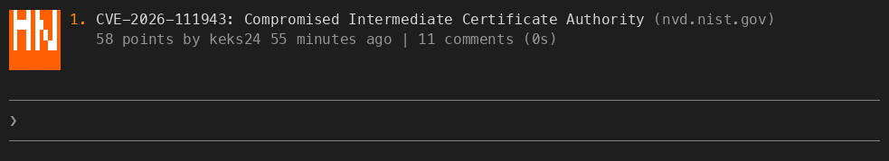

# claude-code-hackernews

A Claude Code mod that puts the Hacker News front page in the spinner. While
Claude works, a small orange HN tile takes the spinner's place, beside one of
the top 30 stories as HN lays it out: rank and title on the first line, points,
author, age and comments under it.



A new story every six seconds, rank 1 to 30 and round again. The rotation
only moves while it is on screen, so the next turn picks up where the last one
stopped. Each time the story changes, the letters roll up out of the tile and
back in from below, like a ticker; halfway through a story a band sweeps across
it.


The title links to the article (to the HN thread for an Ask HN), and the
comments link to the HN thread. They are terminal hyperlinks (OSC 8): in
iTerm2, Ghostty, kitty or WezTerm, cmd-click or ctrl-click one to open it. A
terminal without them draws the URL after the text instead, and the line is
cut to fit.

## Install

```
/plugin install hackernews --marketplace whirlwin/claude-code-hackernews
```

Answer `y` to add the marketplace, then pick a scope.

## Update

`/plugin update` installs from the local clone of the marketplace and does
not fetch it first, so refresh the clone before updating:

```
claude plugin marketplace update claude-code-hackernews
claude plugin update hackernews@claude-code-hackernews
```

Then run `/reload-plugins` in an open session, or restart Claude Code.

## Use

| Command | What it does |
| --- | --- |
| `/hackernews` | hide the front page, or bring it back; says why it could not be fetched, if it could not |
| `/hackernews next` | skip straight to the next story |

## With other mods

Only one mod can draw its own spinner: with another installed that does, which
one shows depends on the order the engine runs their hooks in, which it does
not promise for installed plugins. `/hackernews` hides this one for the
session; `claude plugin disable hackernews@claude-code-hackernews` keeps it off.

The [spotify](https://github.com/whirlwin/claude-code-spotify) mod puts the
song after the spinner's word, and the story takes the place of that word, so
the song does not show while a story does.

## How it works

The stories come from the official Hacker News API: `topstories.json` for the
front page's order, then one request per story for its title, points, author,
age and comment count, 31 requests in parallel through the engine's
`$.http.fetch`. The mod fetches while a turn runs, at most every five
minutes; between turns only `/hackernews` fetches, and only when it has no
list yet. A fetch that fails, or gets no answer within
eight seconds, keeps the last list on screen; with no list yet, it tries again
after 30 seconds, and the spinner shows its own word until one arrives. The
first list starts the rotation at rank 1.

The ranks are the front page's own: a story that is dead, deleted or cannot be
read is left out, and the rest keep their ranks. Everything the API returns is
treated as untrusted, since a title is drawn inside a terminal hyperlink:
control and bidirectional override characters are removed from titles and
author names, and only `http` and `https` URLs become links.

The tile is a `Raster` of quadrant block glyphs, two colors to a cell,
repainted with `$.ui.blit` on a 150 ms clock rather than redrawing the whole
tree. Drawing a tree in the spinner's place drops what the engine draws after
the word (elapsed time, tokens, effort), so the mod shows its own elapsed time.
The token count is not shown. While the engine shows a message of its own in
the spinner, the message replaces the story. In the desktop app only the word
changes, to the story's rank and title.

## Develop

```
claude --plugin-dir .
claude plugin validate .
claude plugin test .
node docs/preview.mjs docs/preview.png
```

The preview script needs Node 22.18 or later, to import `hooks/logo.ts`
without a compile step.

The plugin is named `hackernews` rather than after the repository because
Claude Code reserves plugin names starting with `claude-`. It is not
affiliated with Y Combinator or Hacker News.
